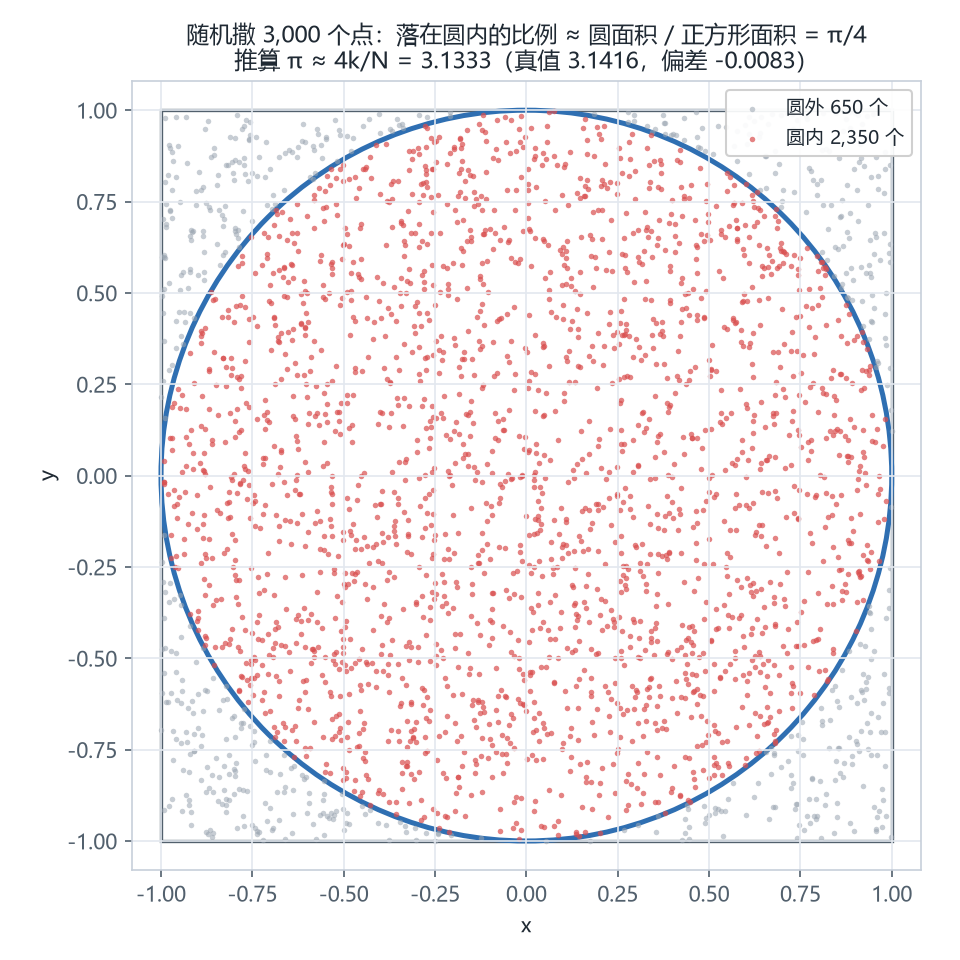
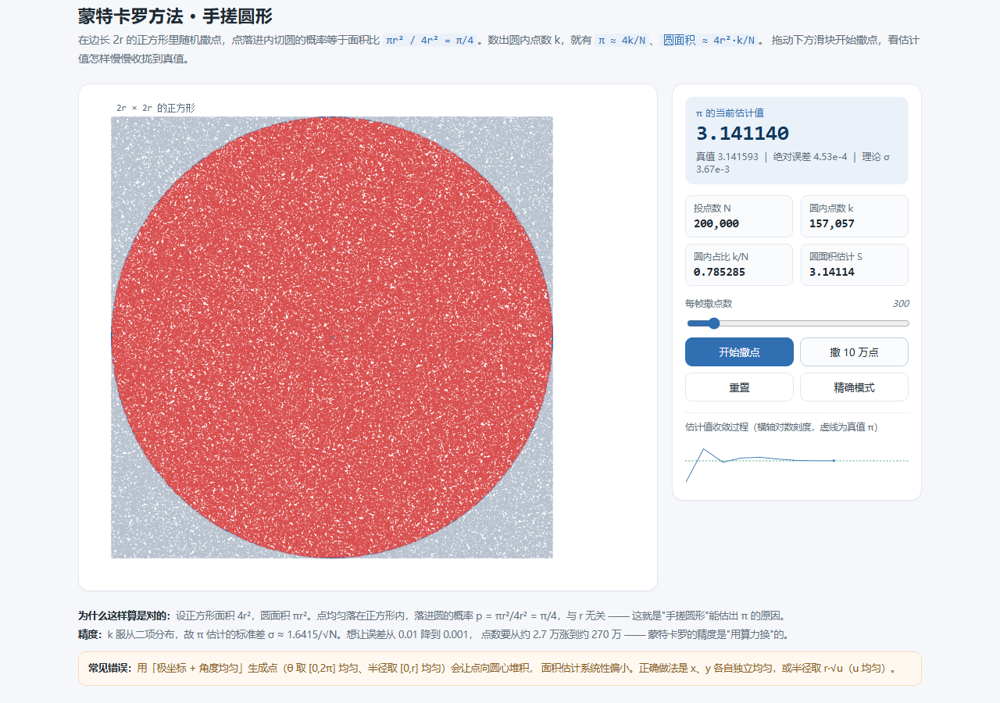
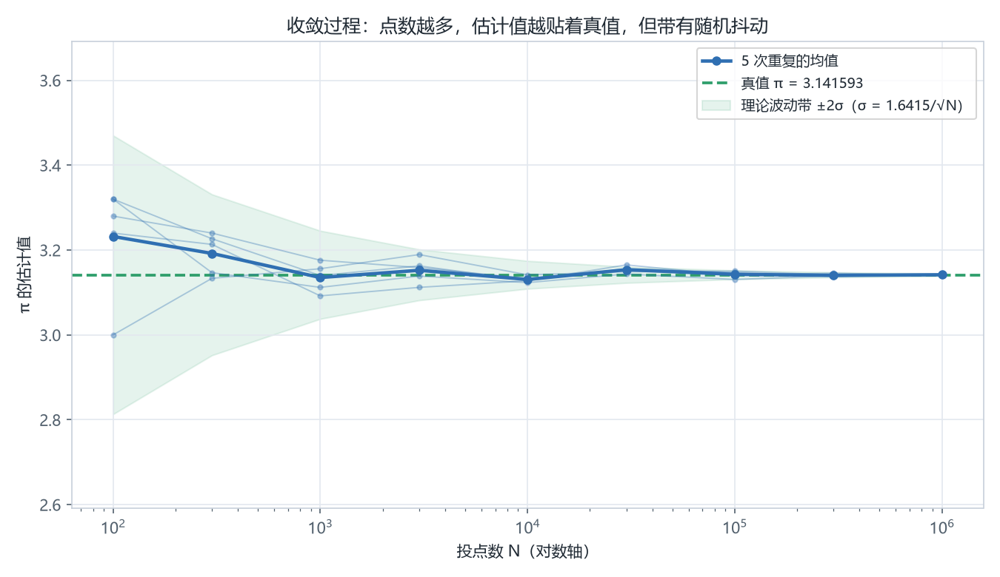
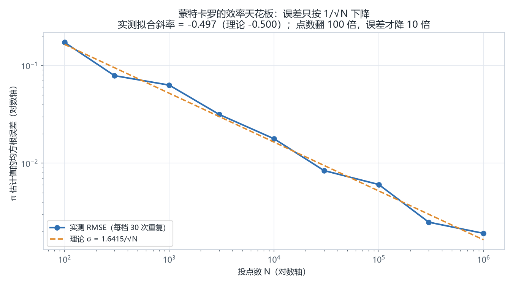
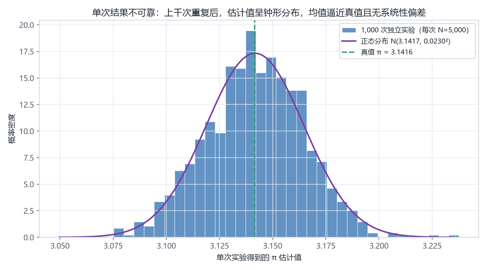

# 蒙特卡罗方法手搓圆形

> 在正方形里随机撒点，用「落在圆内的点数比例」反推圆的面积和 π。
> 全部核心逻辑只用 Python 标准库手写，不调用任何数值库。

```
π ≈ 4k / N          圆面积 ≈ 4r²·k / N
```

其中 `N` 是撒下的点数，`k` 是落在半径 `r` 的圆内的点数。

---

## 一、原理：为什么撒点能算面积

设正方形边长 `2r`，面积 `4r²`；内切圆半径 `r`，面积 `πr²`。

点均匀落在正方形内时，落进圆的概率等于面积比：

```
p = πr² / 4r² = π / 4        ← 与 r 无关，这就是"手搓圆形"能估出 π 的原因
```

因此反复投点，用频率 `k/N` 估计概率 `p`，就有 `π ≈ 4k/N`、`S ≈ 4r²·k/N`。
这就是蒙特卡罗方法：**用随机采样代替解析积分**。

## 二、效果预览



落在圆内的点标红、圆外标灰，红灰比例即 π/4。网页版可以自己拖动撒点：



## 三、三种玩法

### 1. 网页交互演示（推荐先玩这个）

直接用浏览器打开 `index.html`，无需安装任何东西。
可以调「每帧撒点数」看动画、点「撒 10 万点」快速累积、点「精确模式」一次撒 200 万点。

### 2. 命令行跑实验

```bash
python monte_carlo_circle.py                    # 默认 N=1,000,000，重复 10 次
python monte_carlo_circle.py -n 100000 -r 2     # 半径 2 的圆，10 万点
python monte_carlo_circle.py --repeat 200 --export   # 导出 results/*.csv|json
```

核心只有三个函数，加起来不到 40 行：

| 函数 | 作用 |
| --- | --- |
| `random_points(n, r)` | 在 `[-r, r]²` 内均匀生成 n 个点 |
| `count_inside(n, r)` | 用 `x²+y² ≤ r²` 统计落进圆内的个数 k |
| `estimate_pi(n, r)` | 返回 π 估计、面积估计和误差信息 |

### 3. 生成四张分析图

```bash
pip install matplotlib
python visualize.py     # 输出到 results/
```

| 图 | 想说明的问题 |
| --- | --- |
| `01_scatter.png` | 随机点长什么样，圆内圆外怎么分色 |
| `02_convergence.png` | 点数变多，估计值如何向真值收敛 |
| `03_distribution.png` | 单次结果不可靠：上千次重复后呈钟形分布 |
| `04_error_decay.png` | 误差随 N 衰减的斜率，验证 1/√N 规律 |

## 四、实验结果（N = 1,000,000，重复 10 次）

| 指标 | 数值 |
| --- | --- |
| 圆内点数 k | 785,596（占比 0.785596，理论值 π/4 = 0.785398） |
| 单次 π 估计 | 3.142384（绝对误差 0.000791） |
| 10 次估计均值 | 3.141697（真值 3.141593） |
| 95% 置信区间 | [3.141199, 3.142194] —— 包含真值 |
| 平均绝对误差 | 0.000577 |
| 耗时 | 单次 0.40 s（纯 Python，百万点） |

收敛过程（每档重复 10 次）：

| N | π 估计均值 | 绝对误差 | 理论 σ |
| --- | --- | --- | --- |
| 100 | 3.2040 | 6.24e-2 | 1.64e-1 |
| 1,000 | 3.1316 | 9.99e-3 | 5.19e-2 |
| 10,000 | 3.1345 | 7.07e-3 | 1.64e-2 |
| 100,000 | 3.1401 | 1.46e-3 | 5.19e-3 |
| 1,000,000 | 3.1421 | 4.74e-4 | 1.64e-3 |





## 五、误差分析：为什么精度上不去

`k` 服从二项分布 `B(N, π/4)`，于是 π 估计量的标准差：

```
σ_π = 4·√(p(1-p)/N) ≈ 1.6415 / √N
```

实测在 `N` 从 10² 到 10⁶ 的 RMSE 上做 log-log 拟合，**斜率 −0.497**（理论 −0.500），
说明 1/√N 规律成立。代价是极其昂贵：

| 想达到的误差 | 需要点数 |
| --- | --- |
| 0.01 | ≈ 2.7 万 |
| 0.001 | ≈ 270 万 |
| 0.0001 | ≈ 2.7 亿 |
| 0.000001 | ≈ 2.7 万亿 |

**误差降 10 倍，点数要涨 100 倍**。所以蒙特卡罗不是"万能解法"：它适合高维积分、
几何形状不规则、或者解析解根本写不出来的问题；维度越高，它相对网格法的优势越大。



上千次独立实验（每次 N=5,000）得到的估计值呈钟形分布，叠加的正态曲线与直方图基本吻合 ——
这也是中心极限定理在此处生效的直观证据。

## 六、一个常见的坑

用「极坐标 + 角度均匀」生成点看似更"圆"：

```python
theta = random.uniform(0, 2 * math.pi)
r = random.uniform(0, 1)        # ← 错！
x, y = r * math.cos(theta), r * math.sin(theta)
```

半径在 `[0, r]` 上均匀会让点**向圆心堆积**（越靠近圆心，同一半径区间对应的面积越小），
面积估计系统性偏小。正确写法是半径取 `r·√u`（`u` 均匀），或者干脆用 `x、y` 各自独立均匀。

## 七、目录结构

```
monte-carlo-circle/
├── monte_carlo_circle.py   # 核心算法（纯标准库）+ 命令行入口
├── visualize.py            # 四张分析图（依赖 matplotlib）
├── index.html              # 交互式网页演示（Canvas，单文件、移动端可用）
├── results/                # 生成的图 + convergence.csv / summary.json
├── screenshots/            # 网页演示截图
└── requirements.txt
```

## 八、复现环境

- Python 3.9+（核心脚本无第三方依赖）
- `matplotlib` 仅 `visualize.py` 需要
- 网页演示：Chrome / Edge / Safari 任意现代浏览器

```bash
git clone https://github.com/dan051203000-wq/monte-carlo-circle.git
cd monte-carlo-circle
python monte_carlo_circle.py
python visualize.py
```
